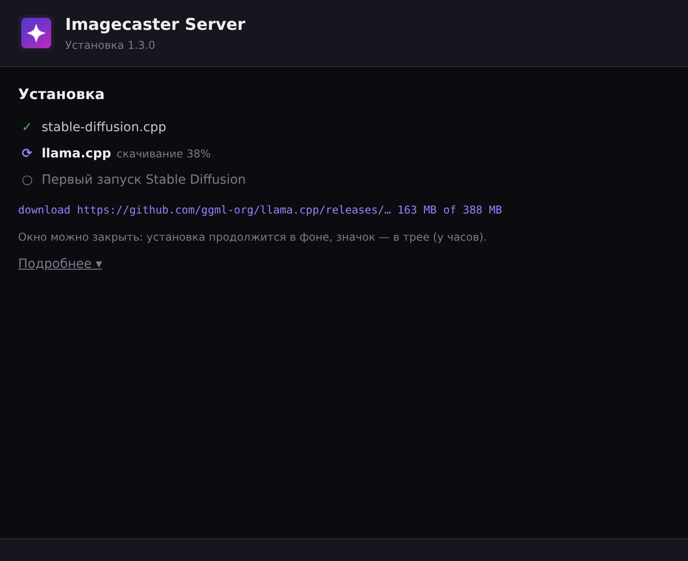
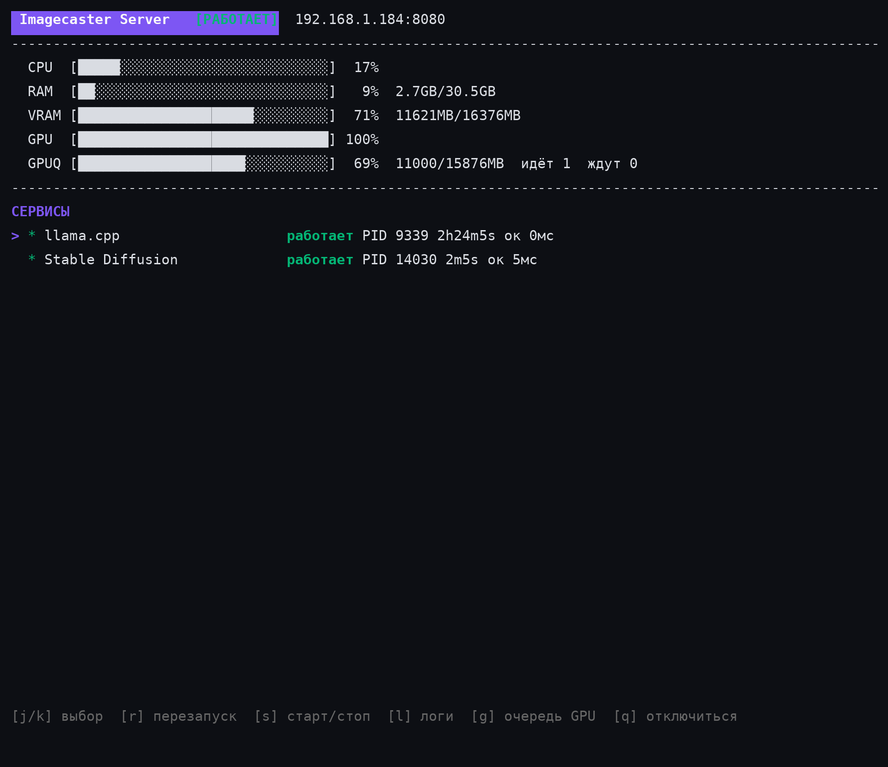
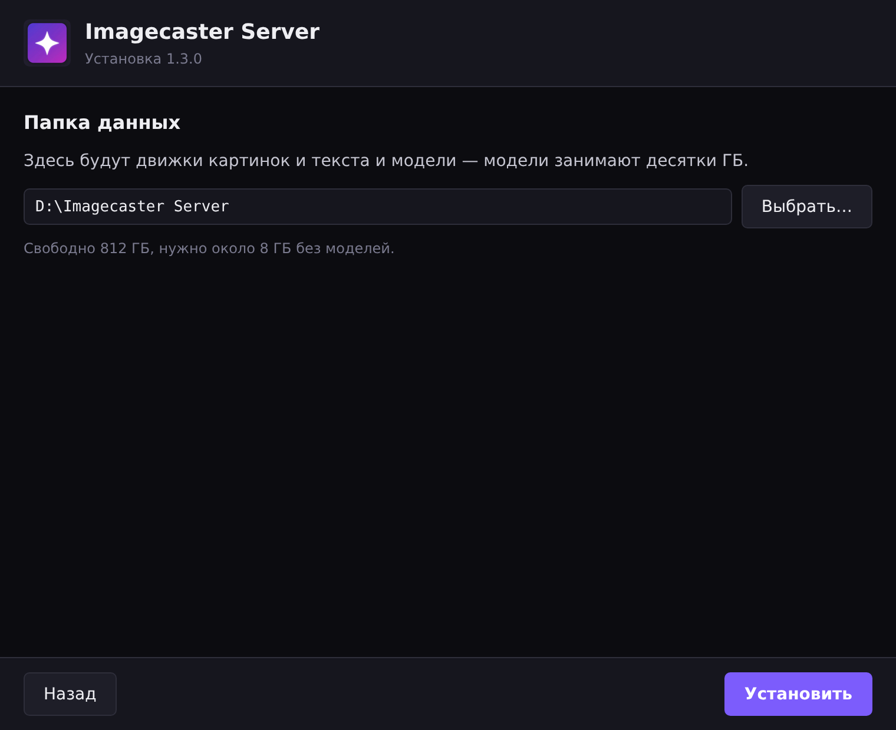

# Imagecaster Server

[English](README.md)

Запускает генерацию картинок (**stable-diffusion.cpp**) и текстовые модели (**llama.cpp**) на компьютере с видеокартой для приложения [Imagecaster](https://github.com/Zazza/imagecaster). Сам всё ставит в одну папку, запускает и перезапускает сервисы и пропускает все запросы к видеокарте через одну очередь, чтобы памяти на карте всегда хватало. Imagecaster находит сервер в локальной сети сам (mDNS).

<p>
  
  
</p>

- Windows, Linux, macOS — без WSL и без Docker
- Одна очередь с бюджетом видеопамяти на всё: задания картинок, текстовые запросы и любая другая программа, которая ходит на стандартные порты SD (`:7860`) и LLM (`:11434`)
- Текстовые модели работают на llama.cpp — программа Ollama не ставится и не нужна; API совместим с ней, поэтому существующие инструменты продолжают работать
- В систему ничего не прописывается и с ней не запускается: сервер запускаете вы, когда он нужен
- Интерфейс на русском или английском — по языку системы

## Установка

Архивы — на странице [Releases](https://github.com/Zazza/imagecaster-server/releases) (собирает CI по тегу `v*`); рядом с каждым архивом лежит контрольная сумма `.sha256`.

| Система | Архив | Внутри |
|---------|-------|--------|
| Windows x64 | `.zip` | `imagecaster-server.exe` (окно установки + трей), `imagecaster-server-console.exe` (панель в терминале) |
| Linux x64 | `.tar.gz` | `imagecaster-server` |
| macOS arm64 (Apple Silicon) | `.tar.gz` | `imagecaster-server`, `Imagecaster Server.command` |

Для Linux ARM, Windows ARM и Mac на Intel сборок нет: у stable-diffusion.cpp и llama.cpp нет готовых сборок под них.

Распакуйте куда угодно. Первый запуск скачивает движки — до 4 ГБ без моделей (в основном библиотеки CUDA).

### Windows

1. Запустите `imagecaster-server.exe`.
2. В окне установки выберите папку данных (диск, где есть место; не обязательно C:) и нажмите **Установить**.

    <p></p>

3. Следите за прогрессом — или закройте окно: установка продолжится в фоне.

    <p></p>

4. Когда появится **Готово**, сервер работает дальше: его значок — в трее (у часов).

В меню значка — состояние движка картинок и LLM и пункты: адрес для приложения (щелчок — скопировать), **Панель управления** (терминал с сервисами, логами и очередью GPU), журнал и **Выход** — он всё останавливает. В следующий раз просто снова запустите `imagecaster-server.exe`; повторный запуск с той же папкой только сообщит, что сервер уже работает.

`imagecaster-server-console.exe` — тот же сервер с интерфейсом в терминале (ниже).

### Linux

```bash
tar xzf imagecaster-server-*-linux-amd64.tar.gz
cd imagecaster-server-*-linux-amd64
./imagecaster-server
```

Первый запуск спросит папку данных (Enter — `~/imagecaster-server`) и всё установит. Дальше — панель в терминале. `--headless` — без неё (для службы systemd).

### macOS

Распакуйте архив и откройте `Imagecaster Server.command` (в первый раз — правой кнопкой → Открыть). Он снимает с сервера карантин скачанного файла и запускает его в Терминале; дальше — как на Linux.

> Поддерживается только Apple Silicon; на Mac эта установка ещё не проверялась.

## Что нужно

- Видеокарта NVIDIA со свежим драйвером (сборка под CUDA 12); для других видеокарт — сборка под Vulkan. Без видеокарты генерация идёт на процессоре и очень медленная.
- Место на диске: около 8 ГБ плюс модели (чекпойнт SDXL — ~6,5 ГБ).
- Интернет для первого запуска.

## Панель в терминале

<p></p>

| Клавиша | Главный экран |
|---------|---------------|
| `j`/`k` | выбор сервиса |
| `s` / `r` | старт/стоп, перезапуск |
| `l` | лог сервиса |
| `g` | очередь GPU: приоритет `u`/`d`, отмена `x` |
| `t` | лог сервера |
| `q` | выход (во вложенных экранах — назад) |

`imagecaster-server attach [хост[:порт]]` открывает ту же панель для уже работающего сервера — на этом или другом компьютере; `q` закрывает только панель, сервер продолжает работать.

## Командная строка

| Флаг | Что делает |
|------|------------|
| `--data DIR` | папка данных (по умолчанию — выбранная при первом запуске, иначе `~/imagecaster-server`) |
| `--config FILE` | файл настроек (по умолчанию `<данные>/server-config.yaml`) |
| `--port N` | порт HTTP API (по умолчанию 8080) |
| `--headless` | без интерфейса, журнал в stdout |
| `--version` | показать версию |

Переменные окружения: `IMAGECASTER_LANG=ru|en` — язык интерфейса; `SD_PORT`, `SD_DATA_DIR`, `SD_ACTIVE_BACKEND` перекрывают настройки.

## Как устроено

```
 Imagecaster / любая программа в сети
        │                     │
   :8080 /api/sd/  /api/llm/  │ :7860 (SD)     :11434 (LLM)
        └──────────┬──────────┘
           Imagecaster Server ── очередь GPU (бюджет видеопамяти)
             │            │
     sd-server :7861   llama.cpp :11435   (только loopback)
```

**Одна очередь на всю карту.** Очередь живёт с бюджетом видеопамяти (определённая карта минус резерв). Запуск допускается, только когда его вес влезает в свободный бюджет; остальные ждут в FIFO-очереди с приоритетами. Благодаря бюджету два движка никогда не грузят модели одновременно и не выбивают друг другу память.

**Генерация — это задание, а не запрос.** `POST /api/sd/jobs` сразу отвечает идентификатором и работает в фоне; клиент опрашивает `GET /api/sd/jobs/{id}`, забирает `.../result` и удаляет задание. Отключение клиента генерацию не отменяет — только явная отмена. У каждого задания своя модель, VAE и модули, поэтому два задания с разными моделями подряд работают каждое на своей. Одно задание картинок держит GPU только по одному; ожидающие задания не отбирают бюджет у текстовых моделей.

**Веса.** Задание картинок весит размер своего чекпойнта плюс накладные расходы; текстовый запрос — фиксированный вес; всё лёгкое (списки моделей, health, статус) проходит свободно.

**Текстовые модели уступают дорогу.** Когда задание картинок и загруженная текстовая модель вместе не влезают в бюджет, сервер перед заданием выгружает неактивные текстовые модели (модель, которая отвечает прямо сейчас, не трогается) — при следующем запросе она загрузится сама за пару секунд.

**Ожидание и сбои.** У ли́зов есть TTL, они продлеваются, пока запрос работает; лиз умершего клиента освобождается сам. Ожидание дольше `max_wait_seconds` отвечает `503` с `Retry-After` (задания картинок ждут без ограничения). Если сломалась сама очередь, запрос проходит дальше (fail-open).

**Защита портов.** Сервер занимает стандартные порты SD (`7860`) и LLM (`11434`), а движки переносит на loopback — поэтому через ту же очередь идут запросы любой программы в сети, не только Imagecaster. Внешние потребители GPU могут брать лиз напрямую: `/api/gpu/*`.

**Текстовый движок — llama.cpp.** Программа Ollama не ставится и не запускается. Сервер отдаёт API, совместимый с Ollama (`/api/llm/` и порт `11434`, плюс OpenAI-совместимый `/v1/chat/completions`), модели хранятся в раскладке Ollama и скачиваются с `registry.ollama.ai` или `hf.co` (`hf.co/<user>/<repo>:<квант>`). Модели уже установленного Ollama подхватываются без повторного скачивания, только для чтения.

Подробно: [docs/server-ru.md](docs/server-ru.md).

## Разработка

```bash
go build -o imagecaster-server .
go test ./... -count=1 -timeout 120s
go vet ./...
make build-windows   # imagecaster-server.exe (окно + трей) и imagecaster-server-console.exe
```

Сборка Windows с окном и треем: `-tags desktop,production -ldflags -H windowsgui` (Wails + systray, без cgo). Релизы собирает `.github/workflows/release.yml` по тегу `v*`.

## Документация

- [Полная документация (Русский)](docs/server-ru.md)
- [Full documentation (English)](docs/server-en.md)
- [Список изменений](CHANGELOG.md)
