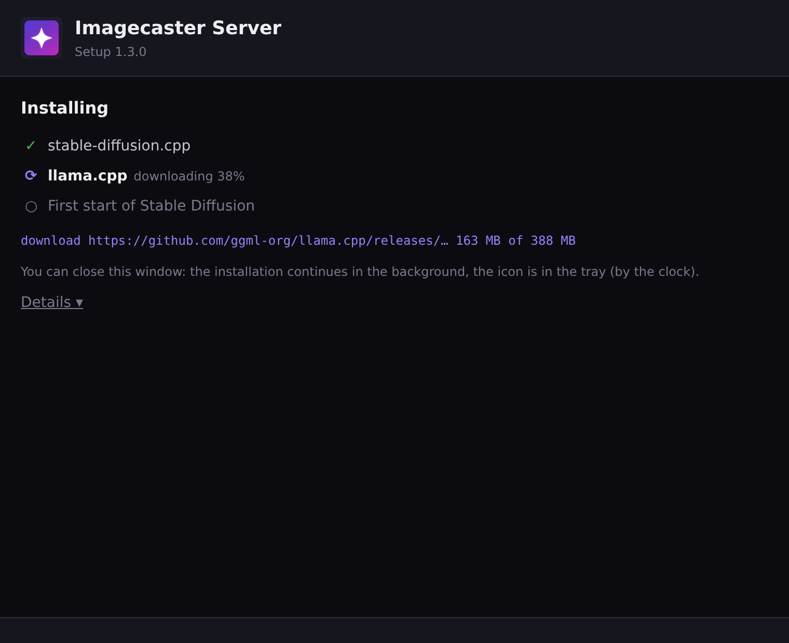
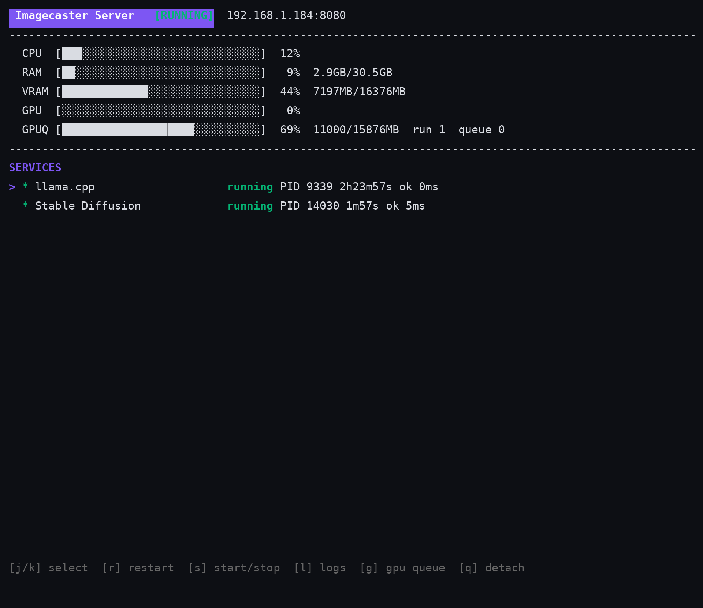
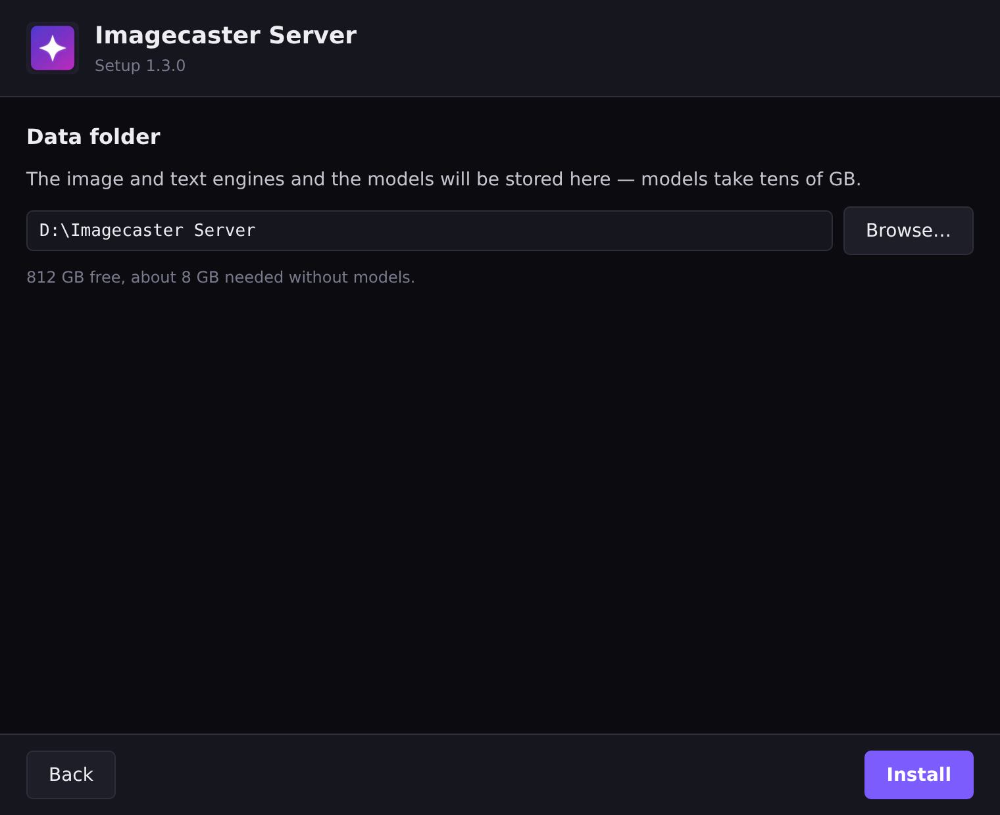

# Imagecaster Server

[Русский](README-ru.md)

Runs image generation (**stable-diffusion.cpp**) and text models (**llama.cpp**) on a computer with a graphics card for the [Imagecaster](https://github.com/Zazza/imagecaster) app. It installs everything itself into one folder, starts and restarts the services, and puts every GPU request through one queue so the card never runs out of video memory. Imagecaster finds the server on the local network by itself (mDNS).

<p>
  
  
</p>

- Windows, Linux, macOS — no WSL, no Docker
- One VRAM-budget queue for everything: image jobs, text requests and any other program talking to the standard SD (`:7860`) or LLM (`:11434`) ports
- Text models run on llama.cpp — the Ollama program is not installed and not needed; its API is compatible, so existing tools keep working
- Nothing is registered in the system and nothing starts with it: you start the server when you need it
- Interface in English or Russian, chosen from the system language

## Install

Release archives are on the [Releases](https://github.com/Zazza/imagecaster-server/releases) page (built by CI on a `v*` tag); each archive has a `.sha256` checksum next to it.

| System | Archive | Inside |
|--------|---------|--------|
| Windows x64 | `.zip` | `imagecaster-server.exe` (setup window + tray), `imagecaster-server-console.exe` (terminal UI) |
| Linux x64 | `.tar.gz` | `imagecaster-server` |
| macOS arm64 (Apple Silicon) | `.tar.gz` | `imagecaster-server`, `Imagecaster Server.command` |

There are no builds for Linux ARM, Windows ARM and Intel Macs: stable-diffusion.cpp and llama.cpp have no ready builds for them.

Unpack anywhere. The first start downloads the engines — up to about 4 GB without models (most of it CUDA libraries).

### Windows

1. Start `imagecaster-server.exe`.
2. In the setup window choose the data folder (a drive with free space; not necessarily C:) and press **Install**.

    <p></p>

3. Watch the progress, or close the window — installing continues in the background.

    <p></p>

4. When it says **Ready**, the server keeps running: its icon is in the tray (by the clock).

The tray menu shows the state of the image engine and the LLM and has: the address for the app (click to copy), **Dashboard** (terminal with services, logs and the GPU queue), the log, and **Exit** — it stops everything. Next time just start `imagecaster-server.exe` again; a second start with the same folder only says the server is already running.

`imagecaster-server-console.exe` is the same server with the terminal interface (see below).

### Linux

```bash
tar xzf imagecaster-server-*-linux-amd64.tar.gz
cd imagecaster-server-*-linux-amd64
./imagecaster-server
```

The first start asks for the data folder (Enter — default `~/imagecaster-server`) and installs everything. Then the terminal dashboard is shown. `--headless` runs without it (for a systemd service).

### macOS

Unpack the archive and open `Imagecaster Server.command` (the first time: right click → Open). It removes the download quarantine from the server and starts it in Terminal; the rest is the same as on Linux.

> Only Apple Silicon is supported; this setup has not been tested on a Mac yet.

## Requirements

- NVIDIA graphics card with a recent driver (CUDA 12 build); other cards use the Vulkan build. Without a graphics card generation runs on the CPU and is very slow.
- Free disk space: about 8 GB plus models (an SDXL checkpoint is ~6.5 GB).
- Internet for the first start.

## Terminal interface

<p></p>

| Key | Main screen |
|-----|-------------|
| `j`/`k` | select a service |
| `s` / `r` | start/stop, restart |
| `l` | service log |
| `g` | GPU queue: priority `u`/`d`, cancel `x` |
| `t` | server log |
| `q` | quit (in sub-screens: back) |

`imagecaster-server attach [host[:port]]` opens the same dashboard for a server that is already running — locally or on another computer; `q` closes only the dashboard, the server keeps running.

## Command line

| Flag | Meaning |
|------|---------|
| `--data DIR` | data folder (default: the one chosen at the first start, otherwise `~/imagecaster-server`) |
| `--config FILE` | config file (default `<data>/server-config.yaml`) |
| `--port N` | HTTP API port (default 8080) |
| `--headless` | no interface, log to stdout |
| `--version` | print the version |

Environment: `IMAGECASTER_LANG=ru|en` — interface language; `SD_PORT`, `SD_DATA_DIR`, `SD_ACTIVE_BACKEND` override the config.

## How it works

```
 Imagecaster / any program in the LAN
        │                     │
   :8080 /api/sd/  /api/llm/  │ :7860 (SD)     :11434 (LLM)
        └──────────┬──────────┘
           Imagecaster Server ── GPU queue (VRAM budget)
             │            │
     sd-server :7861   llama.cpp :11435   (loopback only)
```

**One queue for the whole card.** The queue works with a VRAM budget (detected video memory minus a reserve). A request is admitted only when its weight fits into the free budget; the rest wait in a FIFO queue with priorities. The budget is the single reason two engines never load models at the same time and run out of memory.

**Image generation is a job, not a request.** `POST /api/sd/jobs` answers at once with a job id and runs in the background; the client polls `GET /api/sd/jobs/{id}`, takes `.../result` and deletes the job. A client that disconnects does not cancel the generation — only an explicit cancel does. Every job carries its own model, VAE and modules, so two jobs with different models in a row each run on their own. Only one image job holds the GPU at a time; waiting jobs don't take budget away from text models.

**Weights.** An image job weighs its checkpoint file size plus overhead; a text request has a fixed weight; everything light (model lists, health, status) passes freely.

**Text models step aside.** When an image job and the loaded text model don't fit into the budget together, the server unloads idle text models before the job (a model answering right now is not touched) — it loads again by itself on the next request in a couple of seconds.

**Waiting and failures.** Leases have a TTL and are renewed while the request runs; a lease of a dead client frees itself. Waiting longer than `max_wait_seconds` answers `503` with `Retry-After` (image jobs wait without a limit). If the queue itself misbehaves, the request passes through (fail-open).

**Port guard.** The server takes the standard SD (`7860`) and LLM (`11434`) ports and moves the engines to loopback ports — so requests from any program in the LAN, not only Imagecaster, go through the same queue. External GPU consumers can take a lease directly: `/api/gpu/*`.

**Text engine is llama.cpp.** The Ollama program is neither installed nor started. The server exposes an Ollama-compatible API (`/api/llm/` and port `11434`, plus OpenAI-style `/v1/chat/completions`), models are stored in the Ollama layout and pulled from `registry.ollama.ai` or `hf.co` (`hf.co/<user>/<repo>:<quant>`). Models of an already installed Ollama are picked up read-only, without re-downloading.

Details: [docs/server-en.md](docs/server-en.md).

## Development

```bash
go build -o imagecaster-server .
go test ./... -count=1 -timeout 120s
go vet ./...
make build-windows   # imagecaster-server.exe (window + tray) and imagecaster-server-console.exe
```

The Windows window/tray build uses `-tags desktop,production -ldflags -H windowsgui` (Wails + systray, no cgo). Releases are built by `.github/workflows/release.yml` on a `v*` tag.

## Documentation

- [Full documentation (English)](docs/server-en.md)
- [Полная документация (Русский)](docs/server-ru.md)
- [Changelog](CHANGELOG.md)
